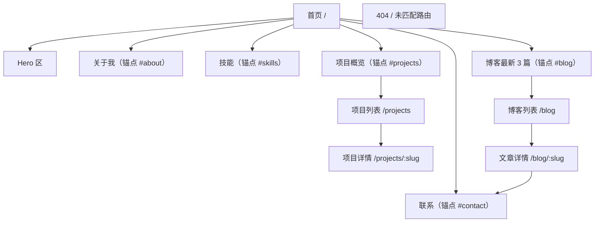

# 个人展示网站 PRD

| 项目 | 内容 |
|---|---|
| 文档版本 | v1.0 |
| 最后更新 | 2026-10-15 |
| 文档状态 | 已确认，进入开发 |
| 关联文档 | [TECH_DESIGN.md](./TECH_DESIGN.md)（技术设计）、[AGENTS.md](./AGENTS.md)（开发规范） |

---

## 一、产品定位

一个用于对外展示个人形象的静态站点，把「我是谁、我会什么、我做过什么、我在想什么」四件事在一个页面里讲清楚，并提供一条可靠的联络通道。

**目标用户与访问动机**

| 用户 | 访问动机 | 期望在多久内得到答案 |
|---|---|---|
| 招聘方 / HR | 快速判断技能与经历是否匹配岗位 | 30 秒内看完 Hero 与技能、项目概览 |
| 潜在合作方 / 客户 | 确认技术能力与项目真实度，判断是否可合作 | 2 分钟内看完 2–3 个项目详情 |
| 同行 / 读者 | 从博客获取技术内容 | 由搜索或分享链接直接落到文章页 |
| 站主本人 | 持续沉淀项目与博客内容，替换简历 | 新增一个 Markdown 文件即可上线内容 |

**三条核心用户旅程**

1. **快速评估路径**：首页 Hero → 技能展示 → 项目卡片 → 点击「看项目」或「下载简历」。
2. **深度求证路径**：首页 → 项目卡片 → 项目详情页 → 仓库 / 演示链接 → 联系表单留言。
3. **内容消费路径**：首页 → 博客列表 → 文章详情 → 阅读目录跳转 → 文末联系。

---

## 二、信息架构

路由共 6 条：`/`、`/projects`、`/projects/:slug`、`/blog`、`/blog/:slug`，以及兜底 404。

---

## 三、核心功能

### 3.1 模块总览与优先级

| 模块 | 功能点 | 优先级 |
|---|---|---|
| 首页 Hero | 头像、姓名职位、一句话介绍、CTA（看项目 / 下载简历 / 联系） | P0 |
| 个人介绍 | 简介段落、经历时间线、教育背景 | P0 |
| 技能展示 | 分类展示，图标 + 名称 + 熟练度 | P0 |
| 项目展示 | 卡片列表（封面、描述、技术标签、链接）+ 详情页 | P0 |
| 博客 | 列表（标题、摘要、日期、标签、阅读时长）+ Markdown 详情（代码高亮、TOC） | P0 |
| 联系 | 邮箱可复制、社交链接、表单（校验 + 反馈） | P0 |
| 全局 | 吸顶导航、页脚、锚点滚动、星空背景 | P0 |
| 404 页 | 兜底页面与回首页入口 | P0 |
| 项目标签筛选 | 按技术标签过滤项目列表 | P1 |
| 博客标签筛选 | 按标签过滤文章列表 | P1 |
| 文章上下篇 | 详情页底部上一篇 / 下一篇 | P1 |
| 阅读进度条 | 文章页顶部滚动进度 | P2 |
| 首屏打字机效果 | Hero 职位文案逐字出现 | P2 |
| 站点主题色切换 | 提供 2–3 套强调色供选择 | P2 |
| 构建期统计 | 自动生成阅读时长、站点地图 | P2 |

### 3.2 首页 Hero（P0）

- **功能点**：展示头像、姓名、职位、一句话介绍；三个 CTA 按钮：`看项目`（锚点滚动到 `#projects`）、`下载简历`（下载 `public/resume.pdf`）、`联系我`（滚动到 `#contact`）。
- **空态**：`public/resume.pdf` 不存在时不渲染「下载简历」按钮，而不是给一个 404 链接。
- **异常态**：头像加载失败时回退为姓名首字母的圆形占位块，不出现破图。
- **约束**：Hero 必须在首屏（375×667 视口）内完整可见，不依赖用户滚动。

### 3.3 个人介绍（P0）

- **简介**：2–4 段文字，数据来源 `src/data/site.ts`。
- **经历时间线**：按时间倒序，每项含时间区间、职位、组织、一句话描述。桌面端为垂直时间线（左侧轴线 + 节点），移动端为无轴线的卡片列表。
- **教育背景**：与工作经历共用时间线组件，通过 `type: 'education'` 区分，在视觉上用不同节点样式区分。
- **空态**：时间线数组为空时整块不渲染，不留空标题。

### 3.4 技能展示（P0）

- **功能点**：按分类分组（如 前端 / 后端 / 工程化 / 工具），每项展示图标、名称、熟练度。
- **熟练度表达**：以 5 段进度条表示，并同时提供文字级别（`1–2 了解` / `3 熟悉` / `4 熟练` / `5 精通`）；进度条必须有 `aria-label`（如「React，熟练度 4/5」），不能只靠颜色传达信息。
- **图标来源**：技术栈图标取自 `simple-icons`，界面图标取自 `lucide-react`。
- **异常态**：无对应图标的技术栈使用首字母占位方块，不出现破图或空白。
- **响应式**：`<640` 单列 / `640–1024` 两列 / `>1024` 按分类分组多列。

### 3.5 项目展示（P0）

- **卡片列表**：每张卡片包含封面图、标题、一句话描述、技术标签、快捷链接（仓库 / 演示）。
- **详情页**：封面、标题、时间、技术标签、外部链接、Markdown 正文（背景 / 方案 / 成果 / 复盘）。
- **筛选（P1）**：顶部标签筛选栏，选中标签后列表实时过滤；命中数量为 0 时展示空态文案「暂无该标签的项目」并提供「清除筛选」。
- **空态**：`src/content/projects/` 下没有可用条目时，展示引导文案「项目整理中」而非空白网格。
- **异常态**：封面缺失时使用渐变占位块 + 项目首字母。
- **排序**：`featured: true` 优先，其次按 `date` 倒序，草稿与 `archived` 状态默认不在列表展示。

### 3.6 博客（P0）

- **列表**：每条含标题、摘要、日期、标签、阅读时长；默认按日期倒序。
- **详情**：Markdown 渲染，支持 GFM 语法（表格、任务列表、删除线）、代码块语法高亮、行内代码、图片、引用、脚注。
- **目录 TOC**：桌面端（`≥1024`）在正文右侧吸附显示，随滚动高亮当前章节；移动端折叠为一个可展开的「本文目录」面板。
- **上下篇（P1）**：详情页底部展示相邻文章，按日期排序。
- **筛选（P1）**：按标签过滤。
- **阅读进度条（P2）**：文章页顶部显示滚动进度。
- **空态**：无文章时展示「还没有发布文章」。
- **异常态**：访问不存在的 slug 时渲染 404 页而不是白屏。
- **草稿规则**：`draft: true` 的文章在开发环境可见并在列表上标注「草稿」，生产构建中排除。
- **内容更新规则**：新增 `.md` 文件后，开发服务器自动热更新并出现在列表中；生产环境需要重新构建（`npm run build`）才会收录。**这是本项目的既有约束，不作为缺陷处理。**

### 3.7 联系（P0）

- **邮箱**：展示邮箱文本 + 一键复制按钮。复制成功后按钮文案在 2 秒内变为「已复制」，并同时通过 `aria-live` 播报；复制 API 失败时降级为选中文本并提示手动复制。
- **社交链接**：GitHub / 掘金 / 知乎 / X 等，图标 + 名称，均为新标签页打开，且带 `rel="noopener noreferrer"`。
- **表单字段**：姓名（1–50 字）、邮箱（合法邮箱格式）、留言（10–1000 字）；另含一个对用户不可见的蜜罐字段用于拦截机器人。
- **校验时机**：失焦校验单个字段，提交时全量校验；错误信息紧贴字段下方，通过 `aria-describedby` 关联，字段标记 `aria-invalid`。
- **五种状态**：`idle`（初始）、`validating`（存在错误）、`submitting`（按钮禁用 + 加载指示）、`success`（显示成功提示并清空表单）、`error`（显示失败原因 + 重试入口，**保留用户已填内容**）。
- **服务端**：接口对同一份数据再次校验，客户端校验不可作为唯一防线。
- **限流**：同一 IP 在 10 分钟内最多提交 3 次，超出返回 429 并提示「提交过于频繁，请稍后再试」。
- **异常态**：网络不可用、接口 5xx、接口返回 429 分别对应不同文案，不向用户暴露内部错误细节。

### 3.8 全局（P0）

- **吸顶导航**：滚动超过 80px 后背景从透明变为毛玻璃（`backdrop-filter: blur`）+ 半透明底色；包含锚点导航与各页面路由入口；当前所在区块高亮（滚动监听）。
- **移动端菜单**：`<768` 收起为汉堡按钮，展开后为全屏或侧滑面板；打开时锁定背景滚动、焦点移入面板，按 `Esc` 关闭并把焦点还给汉堡按钮。
- **页脚**：版权、社交链接、返回顶部按钮、简历入口。
- **锚点滚动**：平滑滚动，且必须通过 `scroll-margin-top`（等于导航高度）避免标题被吸顶导航遮挡；`prefers-reduced-motion: reduce` 时改为瞬时跳转。
- **跳过导航**：提供 skip-to-content 链接，键盘按 `Tab` 首个可达元素，允许直接跳至主内容。
- **星空背景**：全局固定定位，位于所有内容之下，不参与布局、不拦截鼠标事件（`pointer-events: none`）。

---

## 四、设计要求

### 4.1 色彩

| 令牌 | 值 | 用途 |
|---|---|---|
| `--color-bg` | `#0B0F1A` | 页面背景 |
| `--color-surface` | `#111726` | 卡片 / 面板底色 |
| `--color-surface-hover` | `#161D2F` | 卡片悬停底色 |
| `--color-border` | `rgba(230, 234, 242, 0.10)` | 分隔线与卡片描边 |
| `--color-fg` | `#E6EAF2` | 正文文字 |
| `--color-fg-muted` | `#9AA4BF` | 次要文字（需满足 AA：对 `#0B0F1A` 对比度 ≥ 4.5:1） |
| `--color-accent` | `#7DD3FC`（默认，可配置） | 强调色：链接、按钮、选中态、星空星点 |
| `--color-accent-soft` | `rgba(125, 211, 252, 0.12)` | 强调色浅底（标签、悬停底色） |

- 强调色必须通过 CSS 变量暴露，允许在不改组件代码的前提下整体替换。预置三套候选：星蓝 `#7DD3FC`、星紫 `#A78BFA`、极光青 `#5EEAD4`。
- **禁止在组件中硬编码色值**，一律引用令牌。
- 所有文字与背景组合的对比度必须达到 WCAG AA（正文 ≥ 4.5:1，大字号 ≥ 3:1）。

### 4.2 星空背景

- 实现方式为 Canvas 2D 全屏图层，覆盖整站，`position: fixed` + `z-index: 0`。
- 视觉要求：粒子缓慢闪烁（透明度周期性呼吸）、多层视差（不同深度层跟随滚动的位移不同）、无明显规律感。
- **粒子数按断点降级**：`>1024` 约 160 枚，`640–1024` 约 100 枚，`<640` 约 60 枚。
- **设备像素比**：画布按 `devicePixelRatio` 缩放（上限 2），避免高分屏模糊。
- **性能**：`requestAnimationFrame` 驱动；页面进入后台（`visibilitychange`）时暂停；标签页隐藏不消耗 CPU。
- **无障碍**：`prefers-reduced-motion: reduce` 时停止动画，降级为静态深色渐变 + 少量不闪烁星点。
- 不允许使用 `ctx.shadowBlur` 逐粒子模糊，星点应预渲染为离屏贴图后批量绘制。

### 4.3 排版与间距

- 字体：正文使用系统无衬线字体栈（含中文回退），代码使用等宽字体栈；不引入外部字体请求，或使用 `font-display: swap` 自托管。
- 字号层级：Hero 标题 40/56px（移动/桌面）、区块标题 28/36px、卡片标题 20/24px、正文 15–16px（行高 1.7）、辅助文字 13px。
- 间距刻度：4 / 8 / 12 / 16 / 24 / 32 / 48 / 64 / 96。
- 圆角：卡片与面板 16px，按钮与输入框 12px，标签为胶囊形。
- 区块垂直留白：移动端 `64px`，桌面端 `96–120px`，保证「留白充足、层级清晰」。
- 层级通过「字号 + 字重 + 颜色深浅」三重区分，不依赖单一手段。

### 4.4 动效

- 统一缓动曲线（如 `cubic-bezier(0.22, 1, 0.36, 1)`）与统一时长区间（`150–300ms`；入场动画可至 `600ms`）。
- 动效只用于「引导视线」与「状态反馈」，不做无意义的持续动画。
- 滚动入场：内容进入视口时淡入上移，位移不超过 `16px`。
- 全部动效在 `prefers-reduced-motion: reduce` 下取消或退化为透明度变化。

### 4.5 响应式

| 断点 | 布局 |
|---|---|
| `<640` | 单列；导航收起为汉堡菜单；TOC 折叠 |
| `640–1024` | 两列；导航展开 |
| `>1024` | 三列；内容区最大宽度 1200px 居中；文章 TOC 右侧吸附 |

- 内容区最大宽度 `1200px`，两侧留白在移动端不少于 `20px`。
- 触摸目标最小 `44×44px`。
- 任何断点下都不得出现横向滚动条。

### 4.6 无障碍

- 语义化标签：`header` / `nav` / `main` / `section` / `article` / `footer`，每个区块有可被读屏识别的标题。
- 键盘可完整导航；焦点样式清晰可见（不使用 `outline: none` 而不加替代）。
- 所有图片有 `alt`；纯装饰图 `alt=""`。
- 表单错误通过 `aria-live="polite"` 播报，字段与错误信息用 `aria-describedby` 关联。
- 图标按钮必须有 `aria-label`。
- 不使用颜色作为唯一的信息载体。

---

## 五、内容字段需求

内容以 Markdown 文件承载，字段在构建期校验。完整 schema 见 [TECH_DESIGN.md](./TECH_DESIGN.md)。

### 5.1 博客文章 `src/content/blog/*.md`

| 字段 | 类型 | 必填 | 说明 |
|---|---|---|---|
| `title` | string | 是 | 文章标题，1–80 字 |
| `description` | string | 是 | 摘要，用于列表与 meta，≤ 160 字 |
| `date` | string(ISO) | 是 | 发布日期，格式 `YYYY-MM-DD` |
| `updated` | string(ISO) | 否 | 更新日期 |
| `tags` | string[] | 是 | 标签，可为空数组 |
| `cover` | string | 否 | 封面图路径 |
| `draft` | boolean | 否 | 默认 `false`；为真时生产构建不收录 |
| `readingTime` | number | 否 | 分钟；缺省时按正文字数自动计算 |

### 5.2 项目 `src/content/projects/*.md`

| 字段 | 类型 | 必填 | 说明 |
|---|---|---|---|
| `title` | string | 是 | 项目名 |
| `description` | string | 是 | 一句话描述，≤ 120 字 |
| `date` | string(ISO) | 是 | 项目时间，用于排序 |
| `cover` | string | 是 | 封面图路径；缺失时用占位块 |
| `tags` | string[] | 是 | 技术标签，用于卡片与筛选 |
| `links.repo` | string | 否 | 仓库地址 |
| `links.demo` | string | 否 | 演示地址 |
| `featured` | boolean | 否 | 默认 `false`；为真时在列表中优先展示 |
| `status` | `'active' \| 'wip' \| 'archived'` | 否 | 默认 `active`；`archived` 默认不在列表展示 |

### 5.3 结构化数据（TypeScript）

- `src/data/site.ts`：姓名、职位、一句话介绍、简介段落、头像、邮箱、社交链接、简历路径。
- `src/data/skills.ts`：技能分类与条目（名称、熟练度 1–5、图标）。
- `src/data/experience.ts`：时间线条目（时间区间、职位、组织、描述、`type: 'work' | 'education'`）。

---

## 六、已知限制

本节明确列出「本次不做」与「由此产生的后果」，避免验收阶段产生分歧。

1. **不做预渲染（SSG）**。站点为纯客户端渲染，`index.html` 仅是空骨架，正文由 JavaScript 在浏览器中生成。后果：搜索引擎对非首页路由的收录能力弱，社交平台分享非首页链接时拿不到正确的标题与摘要。缓解措施仅限首页静态 meta 标签与运行时更新 `document.title`。
2. **不做服务端渲染**。首屏内容依赖 JS 执行，极低端设备或禁用 JS 的环境下页面为空。
3. **无数据库、无 CMS**。内容更新需要提交 Markdown 文件并重新构建部署；生产环境新增文章不会自动生效。
4. **无用户系统**。不提供登录、评论、点赞、收藏；联系表单是唯一的留言渠道。
5. **不做国际化**。全站仅中文，不提供语言切换。
6. **不做站内搜索**。文章数量较少，通过标签筛选代替。
7. **无后端数据持久化**。联系表单的消息经接口发信后不落库，接口侧仅保留短时限流计数（进程内存，多实例部署下为尽力而为）。

---

## 七、验收标准

| 编号 | 验收项 | 判定方式 |
|---|---|---|
| A1 | 375px 宽度下无横向滚动 | 在 375×667 视口逐页检查 `document.documentElement.scrollWidth <= clientWidth` |
| A2 | 移动端星空帧率 ≥ 50fps | 在移动端尺寸下用 DevTools Performance 录制 ≥ 5 秒，平均帧率 ≥ 50 |
| A3 | 新增 `.md` 后博客列表自动收录 | 开发服务器运行时新增一个 `.md` 文件，列表无需重启即出现该文章 |
| A4 | 表单具备真实成功与失败反馈 | 正常提交收到成功提示且收到邮件；断网或接口报错时显示错误提示并保留已填内容 |
| A5 | 深色主题下对比度达标 | 正文与背景对比度 ≥ 4.5:1，大字号 ≥ 3:1，用对比度检测工具抽查全部文字颜色组合 |
| A6 | 键盘可完整操作 | 断开鼠标，仅用 `Tab` / `Enter` / `Esc` 完成导航、菜单开合、表单填写与提交 |
| A7 | 构建与类型检查通过 | `npm run build` 与 `tsc --noEmit` 均无错误 |
| A8 | 300px 宽度下布局不崩 | 极限窄屏下内容不重叠、不溢出（不强制无横向滚动，仅要求可用） |
| A9 | 页面加载性能 | Lighthouse（移动端模拟）Performance / Accessibility / Best Practices 三项 ≥ 90。**SEO 项因不做预渲染不设阈值** |
| A10 | 路由直达可访问 | 直接访问 `/blog/xxx`、`/projects/xxx` 并刷新，页面正常渲染而非 404；不存在的 slug 渲染 404 页 |

---

## 八、里程碑

| 阶段 | 内容 | 产出 |
|---|---|---|
| M1 骨架 | Vite + React + TS + Tailwind 初始化、设计令牌、布局与路由骨架 | 空壳站点可跑通全部路由 |
| M2 静态版块 | 星空背景、导航页脚、Hero、个人介绍、技能、项目卡片、首页博客预览 | 首页完整可浏览 |
| M3 内容页 | 项目详情、博客列表、文章详情、Markdown 渲染、代码高亮、TOC | 内容链路闭环 |
| M4 联系与打磨 | 联系表单 + 服务端接口、无障碍、性能优化、验收项逐条核对 | 可上线版本 |

---

## 附：与原始需求提纲的差异说明

| 原始要求 | 本 PRD 处理方式 |
|---|---|
| 「移动端星空帧率 ≥ 50fps」 | 保留为 A2，并补明粒子数降级与设备像素比上限作为达成手段 |
| 「新增 MD 文件后博客列表自动更新」 | 保留为 A3，但限定为「开发环境自动、生产环境需重新构建」，写入已知限制 |
| 「表单提交有成功/失败反馈」 | 升级为 A4，要求真实发信与失败保留输入，并由服务端二次校验 |
| 「深色主题下对比度达标」 | 保留为 A5，给出具体阈值 |
| 未提及 SEO | 因选择不做预渲染，单列「已知限制」并调整 A9 的口径 |
