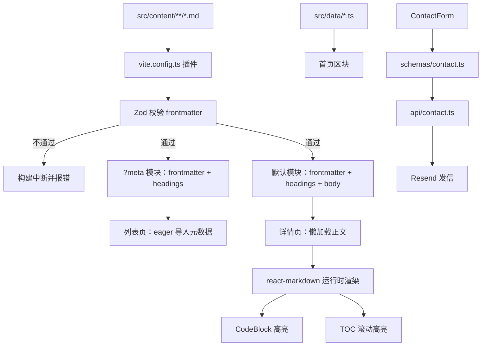
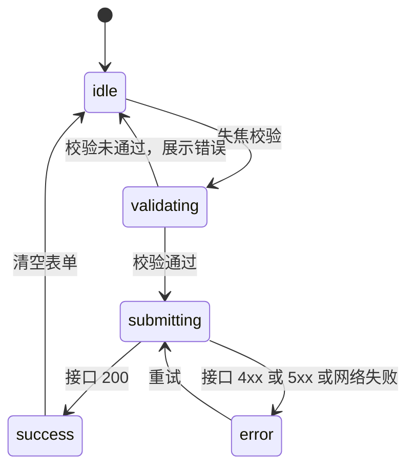

# 个人展示网站 技术设计文档

| 项目 | 内容 |
|---|---|
| 文档版本 | v1.0 |
| 最后更新 | 2026-10-15 |
| 关联文档 | [PRD.md](./PRD.md)（需求）、[AGENTS.md](./AGENTS.md)（开发规范） |

---

## 一、技术栈选择

### 1.1 选型结果

| 层 | 选择 | 版本基调 |
|---|---|---|
| 构建工具 | Vite | 最新稳定版，`@vitejs/plugin-react` |
| 前端框架 | React | 19.x，函数组件 + Hooks |
| 语言 | TypeScript | strict 模式，`noUncheckedIndexedAccess` 开启 |
| 样式 | Tailwind CSS | v4（CSS-first，`@theme` 声明令牌）+ `@tailwindcss/vite` |
| 路由 | react-router-dom | v7，`BrowserRouter` + 声明式路由 |
| Markdown 渲染 | react-markdown + remark-gfm + rehype-slug + rehype-highlight | 运行时渲染 |
| 内容校验 | Zod | 构建期校验 Markdown frontmatter，运行期校验表单 |
| 表单接口 | Vercel Functions（`api/contact.ts`）+ Resend | Node 运行时 |
| 测试 | Vitest + React Testing Library + jsdom | 单元与组件测试 |
| 图标 | lucide-react（界面）+ simple-icons（技术栈） | 按需引入 |
| 代码质量 | ESLint（`typescript-eslint`）+ Prettier | flat config |

### 1.2 关键取舍

**为什么是 Vite 而不是 Next.js / Astro。**
本项目的需求边界由 PRD 第六节划定：不做预渲染、不做服务端渲染、不需要数据库和 CMS，唯一的服务端逻辑是一个转发邮件的接口。在这个边界下，Next.js 的 App Router、数据获取与渲染模式体系属于用不上的复杂度；Astro 的优势（内容集合、零 JS 静态输出）恰好被「不做预渲染」这一决策抵消。Vite 提供最短的构建链路与最直观的心智模型，代价是接受 SEO 较弱的既知限制。

**为什么是运行时渲染 Markdown 而不是构建期编译。**
构建期编译（MDX / 自写插件输出 HTML）能让客户端完全不携带解析器，包体更小；运行时渲染的收益是改样式和自定义组件时无需重新理解编译产物，调试路径短。选择后者后，**必须在构建期解决 frontmatter 与目录的抽取**，否则列表页会连带加载全部正文——这一点在第五节详述，是本方案唯一需要额外工程投入的地方。

**为什么表单走真实接口而不是第三方表单服务。**
原始需求中「表单提交有成功/失败反馈」与「校验」被列为验收项（PRD A4）。真实接口可以完整掌控这五种状态，也能在服务端复用同一份 Zod schema，把校验从「前端装饰」变成真正的防线。

**为什么不做预渲染。**
已与需求方确认并记入 PRD 第六节。若日后需要，接入一个预渲染插件（如 `vite-plugin-prerender` 或迁移到 `vite-plugin-ssr`）即可，现有组件与数据层无需改动。

---

## 二、项目结构

```
personal_site/
├─ index.html                  # 唯一 HTML 入口，放静态 meta / og 标签（唯一的 SEO 抓手）
├─ package.json
├─ tsconfig.json               # 工程引用入口
├─ tsconfig.app.json           # 浏览器侧（strict）
├─ tsconfig.node.json          # 构建脚本与 api 侧
├─ vite.config.ts              # 含自写的 markdown frontmatter 插件
├─ vitest.config.ts            # 复用 vite 配置，jsdom 环境
├─ eslint.config.js
├─ vercel.json                 # SPA 重写 + /api 路由
├─ .env.example                # 环境变量样例（不含真实密钥）
├─ api/
│  └─ contact.ts               # Vercel Function：校验 + 限流 + Resend 发信
├─ public/
│  ├─ resume.pdf               # 简历（缺失时 Hero 隐藏下载按钮）
│  ├─ avatar.webp
│  └─ images/{blog,projects}/  # 封面图
└─ src/
   ├─ main.tsx                 # 挂载入口
   ├─ App.tsx                  # 全局布局：星空 + 导航 + 主内容 + 页脚
   ├─ router.tsx               # 路由表（含 404 兜底与懒加载）
   ├─ vite-env.d.ts            # *.md 模块类型声明、ImportMeta 扩展
   ├─ styles/
   │  └─ global.css            # Tailwind v4 @theme 设计令牌 + 全局基础样式
   ├─ content/
   │  ├─ blog/*.md             # 文章（文件名即 slug）
   │  └─ projects/*.md         # 项目（文件名即 slug）
   ├─ lib/
   │  ├─ content.ts            # 内容装载：列表元数据、详情正文、排序与筛选
   │  ├─ markdown.ts           # react-markdown 配置（插件、组件映射）
   │  ├─ toc.ts                # 目录合并、滚动高亮辅助
   │  └─ reading-time.ts       # 按中英文字数估算阅读时长
   ├─ schemas/
   │  ├─ content.ts            # Markdown frontmatter 的 Zod schema
   │  └─ contact.ts            # 表单 Zod schema（前后端共用）
   ├─ data/
   │  ├─ site.ts               # 个人信息
   │  ├─ skills.ts             # 技能分类与条目
   │  └─ experience.ts         # 经历与教育时间线
   ├─ hooks/
   │  ├─ usePrefersReducedMotion.ts
   │  ├─ useScrollSpy.ts       # 区块高亮 / 目录高亮
   │  ├─ useClipboard.ts
   │  └─ useMediaQuery.ts
   ├─ components/
   │  ├─ layout/
   │  │  ├─ Navbar.tsx         # 吸顶毛玻璃 + 移动端汉堡菜单
   │  │  ├─ Footer.tsx
   │  │  ├─ Section.tsx        # 统一区块容器：标题 + 留白 + 锚点 id
   │  │  └─ SkipLink.tsx
   │  ├─ background/
   │  │  └─ Starfield.tsx      # Canvas 星空
   │  ├─ blog/
   │  │  ├─ PostCard.tsx
   │  │  ├─ PostList.tsx
   │  │  ├─ MarkdownRenderer.tsx   # React.lazy 加载
   │  │  ├─ CodeBlock.tsx          # 代码高亮 + 复制按钮
   │  │  ├─ Toc.tsx
   │  │  └─ TagFilter.tsx
   │  ├─ projects/
   │  │  ├─ ProjectCard.tsx
   │  │  └─ ProjectGrid.tsx
   │  ├─ contact/
   │  │  ├─ ContactForm.tsx
   │  │  ├─ CopyEmail.tsx
   │  │  └─ SocialLinks.tsx
   │  ├─ ui/
   │  │  ├─ Button.tsx
   │  │  ├─ Card.tsx
   │  │  ├─ Tag.tsx
   │  │  ├─ SkillBar.tsx
   │  │  ├─ Timeline.tsx
   │  │  ├─ Spinner.tsx
   │  │  └─ EmptyState.tsx
   │  └─ ErrorBoundary.tsx
   ├─ sections/               # 首页区块编排（只组合，不写业务细节）
   │  ├─ Hero.tsx
   │  ├─ About.tsx
   │  ├─ Skills.tsx
   │  ├─ ProjectsPreview.tsx
   │  ├─ BlogPreview.tsx
   │  └─ Contact.tsx
   └─ pages/
      ├─ HomePage.tsx
      ├─ BlogListPage.tsx
      ├─ BlogPostPage.tsx
      ├─ ProjectsPage.tsx
      ├─ ProjectDetailPage.tsx
      └─ NotFoundPage.tsx
```

### 2.1 目录职责边界

| 目录 | 职责 | 不该做的事 |
|---|---|---|
| `pages/` | 路由级组件：取数据、拼装区块、处理页面级状态 | 不写通用样式细节 |
| `sections/` | 首页区块编排：把 `components` 组合成一个语义区块 | 不直接读取 Markdown 文件 |
| `components/` | 可复用展示与交互单元，尽量无副作用、可测试 | 不感知路由、不发请求（`ContactForm` 除外） |
| `lib/` | 纯函数与数据装载，无 React 依赖 | 不引入 JSX |
| `data/` | 纯静态 TS 数据，带类型 | 不写逻辑 |
| `schemas/` | 单一真相来源的校验规则 | 不放展示逻辑 |
| `api/` | 服务端函数，只被 `vercel` 调用 | 不得被 `src/` 引用 |

---

## 三、数据模型

### 3.1 Markdown frontmatter：Zod schema

`src/schemas/content.ts`

```ts
import { z } from 'zod'

const isoDate = z.string().regex(/^\d{4}-\d{2}-\d{2}$/, '日期格式需为 YYYY-MM-DD')

export const blogFrontmatterSchema = z.object({
  title: z.string().min(1).max(80),
  description: z.string().min(1).max(160),
  date: isoDate,
  updated: isoDate.optional(),
  tags: z.array(z.string()).default([]),
  cover: z.string().optional(),
  draft: z.boolean().default(false),
  readingTime: z.number().positive().optional(),
})

export const projectFrontmatterSchema = z.object({
  title: z.string().min(1).max(80),
  description: z.string().min(1).max(120),
  date: isoDate,
  cover: z.string().optional(),
  tags: z.array(z.string()).default([]),
  links: z
    .object({
      repo: z.string().url().optional(),
      demo: z.string().url().optional(),
    })
    .default({}),
  featured: z.boolean().default(false),
  status: z.enum(['active', 'wip', 'archived']).default('active'),
})

export type BlogFrontmatter = z.infer<typeof blogFrontmatterSchema>
export type ProjectFrontmatter = z.infer<typeof projectFrontmatterSchema>
```

校验时机：**构建期**。由 `vite.config.ts` 中的插件在校验失败时直接抛错中断构建，避免字段写错却静默通过。

### 3.2 内容模块的对外形态

Markdown 文件经插件转换后，对 `src/` 暴露为如下模块：

```ts
export interface MdMeta {
  slug: string
  frontmatter: BlogFrontmatter | ProjectFrontmatter
  headings: TocItem[]
}

export interface MdModule extends MdMeta {
  body: string   // 原始 Markdown 正文，交给 react-markdown 运行时渲染
}

export interface TocItem {
  id: string     // 由 github-slugger 生成，与 rehype-slug 的输出保持一致
  text: string
  depth: number  // 2 | 3 | 4
}
```

### 3.3 页面派生模型

`src/lib/content.ts` 对外提供：

```ts
interface PostListItem {
  slug: string
  title: string
  description: string
  date: string
  tags: string[]
  cover?: string
  readingTime: number   // frontmatter 缺省时由 reading-time.ts 计算
  draft: boolean
}

interface ProjectListItem {
  slug: string
  title: string
  description: string
  date: string
  cover?: string
  tags: string[]
  links: { repo?: string; demo?: string }
  featured: boolean
  status: 'active' | 'wip' | 'archived'
}
```

派生规则：

- **排序**：按 `date` 倒序；项目列表中 `featured: true` 的条目整体前置。
- **草稿过滤**：`import.meta.env.DEV` 为真时保留 `draft` 条目并在卡片上标注「草稿」，生产构建中过滤掉。
- **归档过滤**：`status === 'archived'` 的项目的默认不出现在列表，仅在详情页可达。
- **标签聚合**：由全部条目去重汇总，供筛选栏使用。

### 3.4 结构化数据（`src/data/`）

```ts
// site.ts
export interface SocialLink { label: string; url: string; icon: string }
export interface SiteConfig {
  name: string
  role: string
  tagline: string
  bio: string[]
  location: string
  email: string
  avatar: string
  resumeUrl?: string        // 缺省时 Hero 不渲染「下载简历」
  socials: SocialLink[]
}

// skills.ts
export type SkillLevel = 1 | 2 | 3 | 4 | 5
export interface SkillItem { name: string; level: SkillLevel; icon: string }
export interface SkillGroup { category: string; items: SkillItem[] }

// experience.ts
export interface ExperienceItem {
  id: string
  period: string            // 如 "2022.07 - 至今"
  title: string
  org: string
  description: string
  type: 'work' | 'education'
}
```

### 3.5 表单模型

`src/schemas/contact.ts`——**客户端与服务端导入同一份文件**，是校验规则的唯一真相来源。

```ts
import { z } from 'zod'

export const contactSchema = z.object({
  name: z.string().trim().min(1, '请填写称呼').max(50, '称呼过长'),
  email: z.string().trim().email('邮箱格式不正确').max(120),
  message: z
    .string()
    .trim()
    .min(10, '留言至少 10 个字')
    .max(1000, '留言最多 1000 个字'),
  // 蜜罐：正常用户不可见且应始终为空
  company: z.string().max(0, '提交被拒绝').optional().default(''),
})

export type ContactInput = z.infer<typeof contactSchema>
```

接口返回体约定：

```ts
type ContactResponse =
  | { ok: true }
  | { ok: false; code: 'INVALID' | 'RATE_LIMITED' | 'SEND_FAILED'; message: string; fields?: Record<string, string> }
```

---

## 四、数据流



---

## 五、关键技术点

### 5.1 frontmatter 与目录的构建期抽取（本方案的核心工程点）

问题：运行时渲染意味着客户端要引入 `react-markdown`。如果列表页直接把 Markdown 文件整份导入，正文会全部进入列表页的包；同时目录（TOC）若在运行时解析，等于把正文再解析一遍。

方案：在 `vite.config.ts` 写一个转换插件，把 `.md` 变成 JS 模块，并通过 `?meta` 查询参数提供「只有元数据」的变体。

```ts
// vite.config.ts
import { defineConfig, type Plugin } from 'vite'
import react from '@vitejs/plugin-react'
import tailwindcss from '@tailwindcss/vite'
import matter from 'gray-matter'          // 仅在 Node 侧使用，不进客户端包
import { GithubSlugger } from 'github-slugger'
import { blogFrontmatterSchema, projectFrontmatterSchema } from './src/schemas/content'

function extractHeadings(md: string) {
  const slugger = new GithubSlugger()
  const out: { id: string; text: string; depth: number }[] = []
  let inFence = false
  for (const line of md.split('\n')) {
    if (line.trimStart().startsWith('```')) { inFence = !inFence; continue }
    if (inFence) continue
    const m = /^(#{2,4})\s+(.+?)\s*$/.exec(line)
    if (!m) continue
    const text = m[2].replace(/[`*_]/g, '')
    out.push({ depth: m[1].length, text, id: slugger.slug(text) })
  }
  return out
}

function markdownContent(): Plugin {
  return {
    name: 'markdown-content',
    transform(raw, id) {
      const [file, query = ''] = id.split('?')
      if (!file?.endsWith('.md')) return
      if (!file.includes('/src/content/')) return

      const isProject = file.includes('/src/content/projects/')
      const slug = file.split('/').pop()!.replace(/\.md$/, '')
      const { data, content } = matter(raw)
      const parsed = (isProject ? projectFrontmatterSchema : blogFrontmatterSchema).parse(data)

      const payload = {
        slug,
        frontmatter: parsed,
        headings: extractHeadings(content),
      }

      const fields = `export const slug = ${JSON.stringify(payload.slug)};
export const frontmatter = ${JSON.stringify(payload.frontmatter)};
export const headings = ${JSON.stringify(payload.headings)};`

      // ?meta 变体不携带正文，供列表页使用
      const body = query.includes('meta')
        ? ''
        : `export const body = ${JSON.stringify(content)};`

      return { code: `${fields}\n${body}\nexport default { slug, frontmatter, headings${query.includes('meta') ? '' : ', body'} };`, map: null }
    },
  }
}

export default defineConfig({
  plugins: [react(), tailwindcss(), markdownContent()],
  resolve: { alias: { '@': new URL('./src', import.meta.url).pathname } },
})
```

消费方 `src/lib/content.ts`：

```ts
// 列表页：eager + ?meta，只把元数据打进包
const blogMeta = import.meta.glob<MdMeta>('/src/content/blog/*.md', {
  query: '?meta', eager: true, import: 'default',
})

// 详情页：懒加载，正文按需拉取
const blogBody = import.meta.glob<MdModule>('/src/content/blog/*.md')
```

**注意**：`import.meta.glob` 的查询参数走 `query` 选项而不是写在 glob 字符串里；`?meta` 变体与默认变体读的是同一份文件，由插件按查询参数决定是否输出正文。

**slug 一致性**：插件用 `github-slugger` 生成标题 id，`rehype-slug` 在运行时用同一套算法生成 id，两者输出必须一致，否则 TOC 锚点会点不到。改动任一侧的标题清洗逻辑时需同步另一侧。

### 5.2 README 式风险：`gray-matter` 不能进客户端包

`gray-matter` 依赖 Node 的 `Buffer`，在浏览器中会抛错。它只能出现在：
1. `vite.config.ts`（Node 侧，安全）；
2. `api/`（Node 运行时，安全）。

`src/` 中的任何文件都不得导入 `gray-matter`、`fs`、`path`。`src/` 只消费插件产出的模块。缺省阅读时长计算（`reading-time.ts`）必须是纯字符串运算，不得依赖 Node API。

### 5.3 星空背景（`components/background/Starfield.tsx`）

参数与做法：

| 关注点 | 做法 |
|---|---|
| 图层 | `position: fixed; inset: 0; z-index: 0; pointer-events: none` |
| 高分屏 | `dpr = Math.min(devicePixelRatio \|\| 1, 2)`；画布尺寸 = 视口尺寸 × dpr；`ctx.setTransform(dpr, 0, 0, dpr, 0, 0)` |
| 粒子数 | `>1024` 160 枚 / `640–1024` 100 枚 / `<640` 60 枚 |
| 深度层 | 3 层，`depth` 影响半径、透明度与视差位移系数 |
| 闪烁 | `alpha = base + sin(t * speed + phase) * 0.35` |
| 视差 | 滚动位移 `scrollY * depth * 0.02`，另可在指针设备上叠加以中心为原点的鼠标偏移 |
| 性能 | 星点预渲染为 32×32 离屏贴图，循环内只做 `drawImage`；**禁止逐粒子使用 `ctx.shadowBlur`** |
| 暂停 | `visibilitychange` 隐藏时 `cancelAnimationFrame`，可见时续跑；同时用 `IntersectionObserver` 在画布不可见时暂停 |
| 重排 | `resize` 做 150ms 防抖后重新计算尺寸与粒子位置 |
| 降级 | `prefers-reduced-motion: reduce` 时只绘制一次静态画面，不启动动画循环 |

要点：组件卸载时必须移除 `resize` / `visibilitychange` 监听并取消动画帧，否则路由切换会累积泄漏。React 19 的 StrictMode 会双次执行 effect，清理函数必须幂等。

### 5.4 吸顶毛玻璃导航

- 滚动超过 80px 时给 `<header>` 加 `backdrop-blur` 与半透明底色；用 `useEffect` 监听滚动并**做节流**（`requestAnimationFrame` 或 `passive: true` 监听）。
- 当前区块高亮：用 `IntersectionObserver` 观察各 `Section`，取最靠近视口顶部的区块，而非监听每次滚动计算。
- 移动端菜单：打开时给 `<body>` 加 `overflow: hidden`；面板内首个可聚焦元素自动获得焦点；`Esc` 关闭并归还焦点；面板外点击关闭。
- 锚点遮挡：所有带 `id` 的区块设置 `scroll-margin-top` 等于导航高度（64px / 移动端 56px）。

### 5.5 Markdown 渲染管线

`src/lib/markdown.ts`：

```ts
import type { Components } from 'react-markdown'

export const remarkPlugins = [remarkGfm]
export const rehypePlugins = [
  rehypeSlug,                                   // 生成标题 id，需与构建期 slugger 一致
  [rehypeHighlight, { detect: true, ignoreMissing: true }],  // 只注册必要语言
]
```

- **语言裁剪**：`highlight.js` 全量引入体积很大。做法是只注册实际用到的语言（`ts`、`tsx`、`js`、`jsx`、`json`、`bash`、`css`、`html`、`python`、`sql`），通过自定义 `hljs` 实例传给 `rehypeHighlight` 的 `languages` 选项。
- **分包**：`MarkdownRenderer` 用 `React.lazy` 导入，配合 `<Suspense fallback={<PostSkeleton />}>`，确保首页与列表页不加载解析器与高亮器。
- **代码块**：在 `components` 映射中把 `pre`/`code` 替换为 `CodeBlock`，加上语言标签与「复制」按钮（复用 `useClipboard`）。复制按钮需有 `aria-label`，操作结果通过 `aria-live` 播报。
- **图片**：正文图片加 `loading="lazy"` 与 `decoding="async"`，并包裹为可点击放大的链接（P2）。
- **外链**：正文中的外部链接统一加 `target="_blank"` 与 `rel="noopener noreferrer"`。

### 5.6 目录（TOC）

- 数据来自构建期的 `headings`（`?meta` 或默认模块都带），运行时不再解析正文。
- 只取 `depth` 为 2–4 的标题；`depth` 由嵌套层级决定缩进。
- 滚动高亮用 `IntersectionObserver` 观察 `h2/h3/h4`，维护「当前可见标题」状态；点击目录项时先 `preventDefault` 再滚动，避免改变 URL 造成历史记录污染（需要分享锚点时改为允许修改 hash）。
- 移动端折叠为 `<details>` 或按钮展开的面板；面板内滚动不带动页面。

### 5.7 Tailwind v4 设计令牌

`src/styles/global.css`：

```css
@import "tailwindcss";

@theme {
  --color-bg: #0B0F1A;
  --color-surface: #111726;
  --color-surface-hover: #161D2F;
  --color-border: rgb(230 234 242 / 0.10);
  --color-fg: #E6EAF2;
  --color-fg-muted: #9AA4BF;
  --color-accent: #7DD3FC;
  --color-accent-soft: rgb(125 211 252 / 0.12);

  --radius-card: 16px;
  --radius-control: 12px;

  --ease-standard: cubic-bezier(0.22, 1, 0.36, 1);
  --spacing-section: 4rem;      /* 移动端区块垂直留白 */
}
```

- 强调色同时映射为普通 CSS 变量（`--accent`），使 P2 的主题色切换只需改根节点上的一个变量，无需重新生成 Tailwind 类。
- 组件中**只能**使用令牌派生的类（如 `bg-bg`、`text-fg-muted`、`border-border`、`rounded-card`），禁止 `bg-[#111726]` 这类硬编码。
- 全局基础样式：`color-scheme: dark`、`html { scroll-behavior: smooth }` 并在 reduced-motion 下置为 `auto`、`::selection` 配色、`*:focus-visible` 统一描边。

### 5.8 联系表单与接口

**客户端状态机**（`ContactForm.tsx`）：



- 错误信息紧贴字段，字段标记 `aria-invalid` 并用 `aria-describedby` 指向错误文本节点。
- 提交中禁用按钮并展示 `Spinner`，同时保持表单可读（不清空）。
- 失败时**保留用户输入**，展示可重试的错误提示。
- 状态播报统一放在一个 `aria-live="polite"` 的区域中。

**服务端**（`api/contact.ts`）：

```ts
import type { VercelRequest, VercelResponse } from '@vercel/node'
import { contactSchema } from '../src/schemas/contact'
import { Resend } from 'resend'

const WINDOW_MS = 10 * 60 * 1000
const MAX_HITS = 3
const hits = new Map<string, number[]>()

function rateLimit(ip: string) {
  const now = Date.now()
  const recent = (hits.get(ip) ?? []).filter((t) => now - t < WINDOW_MS)
  if (recent.length >= MAX_HITS) return false
  recent.push(now)
  hits.set(ip, recent)
  return true
}

export default async function handler(req: VercelRequest, res: VercelResponse) {
  if (req.method !== 'POST') return res.status(405).json({ ok: false, code: 'INVALID', message: '不支持的请求方法' })

  const ip = (req.headers['x-forwarded-for'] as string)?.split(',')[0]?.trim() ?? 'unknown'
  if (!rateLimit(ip)) {
    return res.status(429).json({ ok: false, code: 'RATE_LIMITED', message: '提交过于频繁，请稍后再试' })
  }

  const parsed = contactSchema.safeParse(req.body)
  if (!parsed.success) {
    const fields = Object.fromEntries(
      Object.entries(parsed.error.flatten().fieldErrors).map(([k, v]) => [k, v?.[0] ?? ''])
    )
    return res.status(400).json({ ok: false, code: 'INVALID', message: '请检查填写内容', fields })
  }

  const { name, email, message, company } = parsed.data
  if (company) return res.status(400).json({ ok: false, code: 'INVALID', message: '提交被拒绝' })

  try {
    const resend = new Resend(process.env.RESEND_API_KEY)
    await resend.emails.send({
      from: process.env.CONTACT_FROM_EMAIL!,
      to: process.env.CONTACT_TO_EMAIL!,
      replyTo: email,
      subject: `站点留言：来自 ${name}`,
      text: `姓名：${name}\n邮箱：${email}\n\n${message}`,
    })
    return res.status(200).json({ ok: true })
  } catch {
    // 不向客户端泄漏内部错误
    return res.status(500).json({ ok: false, code: 'SEND_FAILED', message: '发送失败，请稍后重试或直接发邮件' })
  }
}
```

要点与限制：

- 限流计数存在**进程内存**中，Vercel 多实例或冷启动后会重置，属于尽力而为的反滥用手段，不能当作严格配额。
- 服务端必须重新校验（复用 `src/schemas/contact.ts`），客户端校验只是体验优化。
- `RESEND_API_KEY`、`CONTACT_TO_EMAIL`、`CONTACT_FROM_EMAIL` 只存在于环境变量中；`.env.example` 只放键名与占位值，`.env*.local` 必须进 `.gitignore`。
- 幂等性低风险（重复提交只是多一封邮件），不引入去重存储。

### 5.9 SPA 回退与部署

`vercel.json`：

```json
{
  "rewrites": [
    { "source": "/api/(.*)", "destination": "/api/$1" },
    { "source": "/(.*)", "destination": "/index.html" }
  ],
  "headers": [
    {
      "source": "/assets/(.*)",
      "headers": [{ "key": "Cache-Control", "value": "public, max-age=31536000, immutable" }]
    }
  ]
}
```

- 重写顺序至关重要：`/api/*` 必须在通配回退之前，否则接口请求会被重写成 `index.html`。
- `/assets/*` 为 Vite 带哈希的产物目录，可长期缓存。
- `index.html` 不得长期缓存，否则新版本无法下发。

### 5.10 本地开发与调试

| 场景 | 命令 | 说明 |
|---|---|---|
| 只调前端 | `npm run dev` | Vite 开发服务器，**`/api/contact` 不可用**，表单会返回错误态 |
| 前后端联调 | `npx vercel dev` | 同时提供前端与 `/api` 函数，是验证表单的**唯一正确方式** |
| 生产预览 | `npm run build && npm run preview` | 静态产物预览，接口同样不可用 |

**这条差异容易在后续被误判为缺陷**，`AGENTS.md` 中会再次强调。

### 5.11 性能预算

| 指标 | 目标 | 手段 |
|---|---|---|
| 首页 JS（gzip） | ≤ 200KB | 路由级 `React.lazy`；`MarkdownRenderer` 与 `CodeBlock` 分包；图标按需导入 |
| 首屏可见 | ≤ 1.5s（本地生产构建） | 星空不阻塞首屏：先渲染内容，画布在 `requestIdleCallback` 或首个 `rAF` 内初始化 |
| 移动端星空帧率 | ≥ 50fps | 粒子数降级 + 离屏贴图 + 禁止阴影模糊 + 不可见时暂停 |
| Lighthouse | Performance / Accessibility / Best Practices ≥ 90 | 见上；SEO 项不设阈值 |
| 布局抖动 | CLS 无可见跳变 | 图片与画布预留尺寸、字体使用系统栈 |

### 5.12 测试策略

| 层次 | 工具 | 覆盖对象 |
|---|---|---|
| 纯函数单测 | Vitest | `lib/content.ts` 的排序/筛选/草稿规则、`lib/reading-time.ts`、`lib/toc.ts` 的目录合并、`schemas/contact.ts` 的校验边界 |
| 组件测试 | Vitest + RTL | `ContactForm` 的五种状态与错误提示、`TagFilter` 过滤行为、`Navbar` 移动端菜单开合与焦点归还 |
| 手工核对 | 浏览器 | PRD 第七节 A1–A10 逐条，含 375px 无横向滚动与星空帧率录制 |

不引入端到端测试框架（Playwright 等），验收以手工核对为准——理由：交互面小，引入 E2E 的维护成本高于收益。

---

## 六、依赖清单

```jsonc
// dependencies
"react", "react-dom", "react-router-dom",
"react-markdown", "remark-gfm", "rehype-slug", "rehype-highlight",
"highlight.js", "github-slugger", "zod",
"lucide-react", "simple-icons",
"resend"                       // 仅被 api/ 使用

// devDependencies
"vite", "@vitejs/plugin-react", "typescript", "@types/react", "@types/react-dom",
"tailwindcss", "@tailwindcss/vite",
"gray-matter",                 // 仅被 vite.config.ts 使用
"@vercel/node",                // api/ 的类型
"vitest", "jsdom", "@testing-library/react", "@testing-library/user-event", "@testing-library/jest-dom",
"eslint", "typescript-eslint", "eslint-plugin-react-hooks", "prettier"
```

**体积警戒线**：`gray-matter`、`resend`、`@vercel/node` 三者都**不得**出现在客户端 bundle 中。构建后可用 `npm run build` 的输出或 bundle 分析确认。

---

## 七、npm scripts

| 脚本 | 命令 | 用途 |
|---|---|---|
| `dev` | `vite` | 前端开发（无接口） |
| `build` | `tsc --noEmit && vite build` | 类型检查 + 生产构建 |
| `preview` | `vite preview` | 本地预览生产产物（无接口） |
| `typecheck` | `tsc --noEmit` | 独立类型检查 |
| `lint` | `eslint .` | 代码规范 |
| `format` | `prettier --write .` | 格式化 |
| `test` | `vitest run` | 单测（CI 用） |
| `test:watch` | `vitest` | 单测（开发用） |
| `dev:full` | `vercel dev` | 前后端联调，表单验证必须用这个 |

---

## 八、环境变量

`.env.example`（提交到仓库）：

```bash
# Resend 发信密钥，仅服务端使用
RESEND_API_KEY=re_xxxxxxxxxxxx
# 收件邮箱（站点所有者）
CONTACT_TO_EMAIL=you@example.com
# 发件地址，需为 Resend 已验证的域名邮箱
CONTACT_FROM_EMAIL=contact@yourdomain.com
```

`.gitignore` 必须包含 `.env`、`.env.local`、`.env.*.local`、`node_modules`、`dist`、`.vercel`。

---

## 九、开发顺序建议

1. `npm create vite` 初始化 + TypeScript strict + Tailwind v4 + 路径别名。
2. `global.css` 设计令牌 → 验证颜色与圆角在页面生效。
3. 布局骨架（`App.tsx` / `router.tsx` / `Section.tsx`）+ 全部路由可跳通，含 404。
4. `Starfield` 独立开发并单独测帧率（此时页面内容少，便于判断性能瓶颈是否来自画布）。
5. 静态区块：`Navbar` → `Hero` → `About` → `Skills` → `ProjectsPreview` → `BlogPreview` → `Footer`。
6. 写入 Markdown 插件与 `lib/content.ts`，打通 `/projects` 与 `/blog` 列表。
7. `MarkdownRenderer` + `CodeBlock` + `Toc`，打通两个详情页。
8. 联系表单 + `api/contact.ts` + `vercel dev` 联调。
9. 无障碍与性能收尾，逐条核对 PRD A1–A10。
